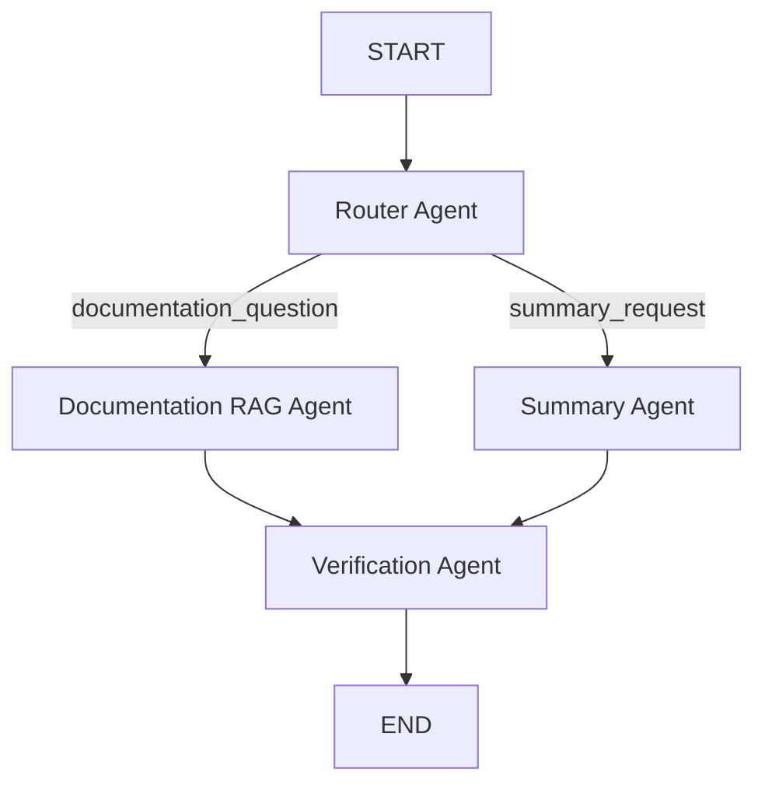

# Multi-Agent FastAPI Documentation RAG Assistant

A backend assistant that answers questions about the **official FastAPI documentation**.

A FastAPI endpoint sends each question through a small LangGraph workflow:



The answer is generated only from retrieved documentation chunks. If those chunks do not support the answer, the API returns a safe message plus the verification result.

## What it uses

- FastAPI for the HTTP API
- LangChain for chat models, embeddings, and prompt chains
- LangGraph for the four-agent workflow
- Gemini or OpenAI through LangChain
- ChromaDB for similarity search
- Structure-aware chunking of real pages from [https://fastapi.tiangolo.com/](https://fastapi.tiangolo.com/)

The indexed pages are a fixed list, not an open web crawl:

- First Steps
- Path Parameters
- Query Parameters
- Request Body
- Response Model
- Dependencies
- Security
- Middleware
- Background Tasks
- Async
- Handling Errors

## Project layout

```text
app/
  domain/            entities and interfaces
  application/       chunking, retrieval, ingestion, use cases
  infrastructure/    LangChain models, ChromaDB, loader, LangGraph agents
  presentation/      FastAPI routes and schemas
  config.py
  dependencies.py
  main.py
data/raw/            downloaded HTML
data/processed/      chunk JSON
data/chroma/         persistent vector store
```

Dependency direction is presentation → application → domain. Infrastructure implements the domain interfaces. The domain package does not import FastAPI, LangChain, LangGraph, ChromaDB, or OpenAI.

## Chunking

Chunking is structure first:

1. The loader splits each page into sections using headings.
2. Paragraphs, lists, and code blocks stay whole.
3. A section that fits in the chunk budget becomes one chunk and keeps its heading.
4. A section that is too large is split recursively, with a short overlap.
5. A code block is divided only when that block alone is too large.

Each chunk stores `source`, `url`, `title`, `section`, `chunk_id`, and `document_type`. Chunk ids are a hash of the URL, section, and index, so running ingestion again updates the same records instead of appending duplicates.

## Setup

```powershell
python -m venv .venv
.venv\Scripts\activate
pip install -r requirements.txt
copy .env.example .env
```

Put a Gemini or OpenAI key in `.env`. Leave `LLM_PROVIDER` empty to auto-select from the key that is present.

```text
GEMINI_API_KEY=your-gemini-key
GEMINI_MODEL=gemini-3.5-flash-lite
GEMINI_EMBEDDING_MODEL=models/gemini-embedding-001
OPENAI_API_KEY=
OPENAI_MODEL=gpt-4.1-mini
OPENAI_EMBEDDING_MODEL=text-embedding-3-small
LLM_PROVIDER=gemini
```

Keys are read from the environment. Do not put them in `.env.example` or source code.

## Ingest the official docs

From the project root:

```powershell
python -m app.infrastructure.ingestion.ingest
```

The same pipeline is available as `POST /ingest`.

This downloads the curated pages into `data/raw/`, writes chunks to `data/processed/`, embeds them, and upserts ChromaDB under `data/chroma/`.

The HTML and chunk files for the curated pages are already in `data/raw/` and `data/processed/`. Chat search still needs the embedding step above, because Chroma is built from your Gemini or OpenAI embeddings and is not created until ingestion runs.

## Run the API

```powershell
python -m app.main
```

- Chat website: `http://127.0.0.1:8000/`
- `GET /health`
- `POST /chat`
- `POST /ingest`
- API explorer at `http://127.0.0.1:8000/docs`

Example:

```powershell
Invoke-RestMethod -Method Post -Uri http://127.0.0.1:8000/chat -ContentType "application/json" -Body '{"question":"How do I create a POST endpoint in FastAPI?"}'
```

The response includes the intent, the specialist agent, the answer, sources, retrieved chunks, and the verification result.

Supported router intents:

- `documentation_question` — for example, "How does Depends work?"
- `summary_request` — for example, "Summarize the FastAPI middleware documentation."

If verification cannot support the draft, `answer` is replaced with a message that the answer could not be fully verified. The verification object still explains which claims failed. There is no automatic regeneration loop.

If the retrieved pages do not contain the answer, the assistant says that the available documentation does not contain enough information.

## Tests

```powershell
pytest
```

Tests cover chunking, HTML extraction on a real First Steps page, the LangGraph route, the HTTP API, and idempotent Chroma ingestion. They use fakes for the language model. Live ingestion needs `GEMINI_API_KEY` or `OPENAI_API_KEY`.
